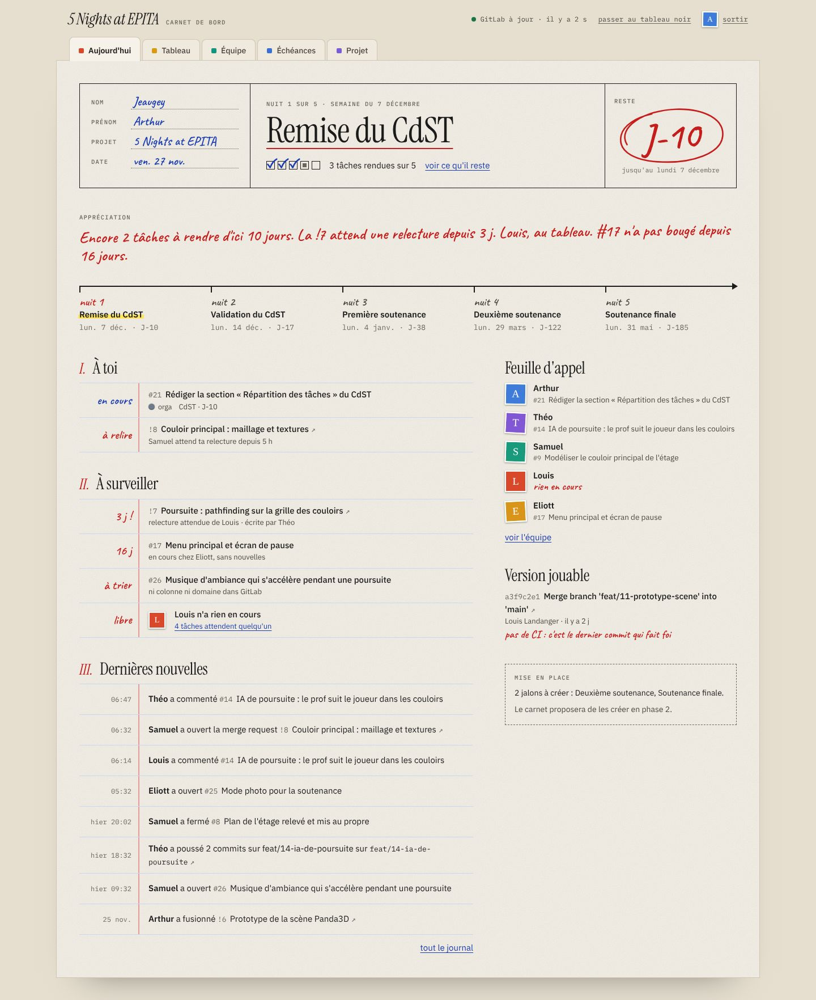

# Carnet de bord — 5 Nights at EPITA

Outil interne du groupe : un **dashboard web** (et bientôt un **bot Discord**) qui donne une vue commune et
vivante du projet *5 Nights at EPITA*, jeu d'horreur 3D en Python / Panda3D, projet annuel de 1re année à
EPITA Lyon.

Les tâches vivent dans GitLab (`arthur.jeaugey/5-nights-at-epita` sur `https://gitlab.cri.epita.fr/`). Le carnet
ne garde jamais sa propre version des tâches : il lit GitLab et, à partir de la phase 2, y écrira.



Autres captures : [tableau](docs/apercu/tableau.jpg), [équipe](docs/apercu/equipe.jpg),
[échéances](docs/apercu/echeances.jpg), [thème nuit](docs/apercu/tableau-noir.jpg),
[téléphone](docs/apercu/telephone.jpg). Les tâches visibles sur ces images sont des **données d'exemple**.

## État

**Phase 1 (lecture seule) écrite — 27 novembre 2026.** Tableau, équipe, échéances, santé du projet, détail d'une
tâche, mise à jour en direct, connexion par le GitLab de l'école. Testée de bout en bout contre un faux GitLab ;
pas encore déployée ni essayée avec la vraie connexion de l'école. Détail : [`docs/ETAT_ACTUEL.md`](docs/ETAT_ACTUEL.md).

## Essayer sur son ordinateur

Il faut Python 3.13, [uv](https://docs.astral.sh/uv/) et Node 22.

```bash
make install
```

Puis trois terminaux :

```bash
make dev-gitlab
```

```bash
make dev-app
```

```bash
make dev-front
```

Ouvrir <http://127.0.0.1:5173>. La page de connexion mène à un **faux GitLab** local qui propose de choisir l'un
des cinq membres (ou un intrus, pour voir le refus). Rien ne touche au vrai GitLab.

Pour voir la mise à jour en direct, modifier une tâche dans le faux GitLab pendant que la page est ouverte :

```bash
curl -X POST 'http://127.0.0.1:8001/_dev/issues/12?webhook=1' -H 'Content-Type: application/json' -d '{"labels":["En cours","gameplay"],"assignees":["louis.landanger"],"par":"louis.landanger"}'
```

`GET http://127.0.0.1:8001/_dev` liste les autres manipulations possibles ; `POST /_dev/reset` remet les
données d'origine.

Pour travailler seulement sur l'interface, sans Python :

```bash
cd frontend && npm run dev:mock
```

## Tests

```bash
make test
```

```bash
make lint
```

```bash
cd frontend && npm run build
```

Les tests n'appellent jamais le vrai GitLab : ses réponses sont simulées.

## Installer sur le serveur

Prérequis : Docker, un domaine géré par Cloudflare, le rôle Maintainer ou Owner sur le projet du jeu.

1. **Token du projet.** Dans le projet du jeu : *Settings → Access tokens*. Rôle **Reporter**, portée
   **`read_api`** (elle passera à `api` en phase 2), expiration au choix.
2. **Application OAuth**, pour la connexion des membres. Avatar → *Edit profile → Applications → Add new
   application*. Redirect URI : `https://<sous-domaine>/auth/callback`. Cocher *Confidential*, et la seule portée
   `openid`.
3. **Tunnel Cloudflare.** *Zero Trust → Networks → Tunnels* : créer un tunnel de type `cloudflared`, lui donner
   un nom d'hôte public (le sous-domaine choisi) qui pointe vers `http://app:8000`, copier son jeton.
4. **Configuration.** Copier `.env.example` vers `.env` et le remplir. Chaque variable y est expliquée.
5. **Lancement.**

   ```bash
   docker compose up -d
   ```

6. **Webhook GitLab** (facultatif mais recommandé : sans lui, le carnet interroge GitLab toutes les 30 secondes).
   *Settings → Webhooks* : URL `https://<sous-domaine>/hooks/gitlab`, le secret choisi dans `.env`, événements
   *Issues, Merge requests, Comments, Pipelines, Push, Tag push, Milestones*. Cliquer **Test**.
7. **Vérifier.** Se connecter, ouvrir l'onglet **Projet** : la rubrique *Synchronisation* indique si GitLab répond
   et si des webhooks arrivent.

Les réglages non secrets (calendrier, membres, noms des labels, seuils) sont dans
[`config/projet.toml`](config/projet.toml) ; après modification, `docker compose restart app`.

Discord : voir [`docs/DISCORD_SETUP.md`](docs/DISCORD_SETUP.md).

## Documentation

| Fichier | Contenu |
|---|---|
| [`docs/ETAT_ACTUEL.md`](docs/ETAT_ACTUEL.md) | Où on en est, ce qui reste à vérifier, prochaine étape |
| [`docs/UX.md`](docs/UX.md) | Parcours, écrans, règles du tableau, apparence |
| [`docs/ARCHITECTURE.md`](docs/ARCHITECTURE.md) | Stack, flux de données, connexion, hébergement, contraintes de l'instance GitLab |
| [`docs/DECISIONS.md`](docs/DECISIONS.md) | Décisions et leur statut |
| [`docs/DISCORD_SETUP.md`](docs/DISCORD_SETUP.md) | Salons, notifications natives de GitLab, préparation du bot |
| [`AGENTS.md`](AGENTS.md) | Règles pour les IA qui travaillent sur ce repo |
| [`docs/ai/AI_LOG.md`](docs/ai/AI_LOG.md), [`docs/ai/journal/`](docs/ai/journal/) | Registre et journaux de l'usage de l'IA |

## Organisation du code

```
app/core/      Règles pures et testées : colonnes, calendrier, alertes, webhooks
app/gitlab/    Client de l'API GitLab, synchro, cache en mémoire
app/web/       Routes, connexion, flux temps réel, en-têtes de sécurité
app/store/     SQLite (état technique seulement)
frontend/      Interface React + TypeScript
config/        Réglages non secrets
dev/           Faux GitLab pour le développement
tests/
```

## Phases

1. **Lecture seule** — écrite, à valider.
2. **Actions** : prendre une tâche, créer une idée, changer de colonne, point hebdo ; bot Discord.
3. **Automatisations et transparence IA** : récap hebdomadaire, rappels, vue « Transparence IA ».
