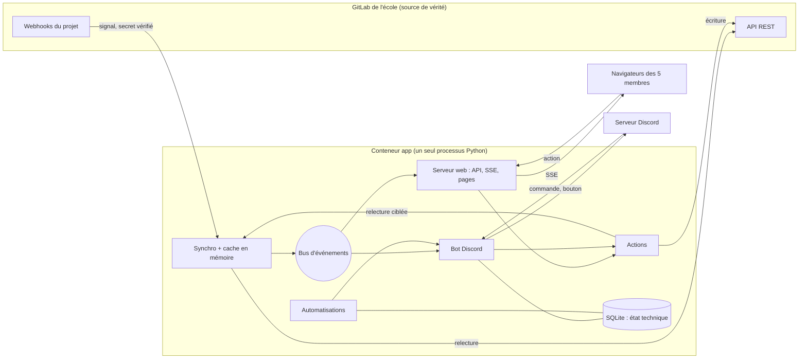

# Architecture

> Statut : architecture **validée par Arthur le 27 novembre 2026** et mise en œuvre pour la phase 1 (lecture
> seule). Les parties « actions », « bot » et « automatisations » décrivent la suite : elles ne sont pas écrites.
> Chaque choix est repris dans `docs/DECISIONS.md` avec son statut.

## 1. Vue d'ensemble

Un seul programme Python contient le serveur web, le bot Discord et les automatisations. Ils partagent le même
cache et le même bus d'événements, ce qui garantit que le dashboard et Discord affichent toujours la même chose.



## 2. Stack proposée

| Brique | Choix | Pourquoi |
|---|---|---|
| Langage serveur | Python 3.12 ou plus | Langage du groupe et du jeu |
| Serveur web | FastAPI + Uvicorn | Asynchrone, donc compatible avec `discord.py` dans le même processus ; validation des données intégrée ; très documenté |
| Client GitLab | `httpx` avec un petit client maison | Une quinzaine de points d'API suffisent ; asynchrone ; facile à simuler dans les tests. Alternative : `python-gitlab`, plus lisible mais synchrone |
| Bot | `discord.py` 2 | Référence en Python ; commandes slash et boutons |
| Connexion | Authlib (OAuth 2 / OpenID Connect) | Évite d'écrire soi-même le protocole |
| Stockage | SQLite, module standard `sqlite3` | Un fichier, aucune base à administrer ; l'état à garder est minuscule |
| Planification | Boucle interne (une vérification par minute) + fonctions pures | Pas de dépendance ; les calculs de rappels se testent sans horloge |
| Frontend | React + TypeScript + Vite | Glisser-déposer, mises à jour instantanées et palette de commandes sont difficiles à bien faire sans vraie application côté navigateur |
| Styles | Tailwind CSS | Thème sombre et clair, responsive, sans feuille de styles à maintenir |
| Données côté navigateur | TanStack Query | Cache, rafraîchissement et mises à jour optimistes |
| Glisser-déposer | dnd-kit | Accessible au clavier |
| Temps réel navigateur | Server-Sent Events (SSE) | Sens unique serveur → navigateur, reconnexion automatique, plus simple que WebSocket |
| Tests | pytest + respx | respx simule les réponses de GitLab |
| Qualité | ruff | Formatage et lint en un outil |
| Dépendances Python | uv | Installation rapide et reproductible |
| Déploiement | Docker + `docker compose` | Une commande pour tout lancer |
| HTTPS | Tunnel Cloudflare | Aucun port ouvert à la maison ; voir section 9 |

Alternative étudiée pour le frontend : pages rendues par le serveur avec HTMX. Avantage : presque tout reste en
Python. Inconvénient : le glisser-déposer, les mises à jour optimistes et la palette de commandes deviennent
laborieux. Elle reste possible si le groupe ne veut pas de TypeScript.

## 3. Organisation du code (cible)

```
app/
  core/          Logique pure, sans réseau : colonnes, calendrier, alertes, webhooks, modèles
  gitlab/        Client de l'API, synchro, cache, bus d'événements
  web/           Routes de l'API, connexion, SSE, en-têtes de sécurité, fichiers du frontend
  store/         SQLite
  actions/       (phase 2) Prendre, créer une idée, déplacer : le seul chemin d'écriture
  bot/           (phase 2) Commandes slash, boutons, notifications
  automations/   (phase 3) Récap hebdomadaire, rappels
frontend/        Application React
config/          Réglages non secrets (calendrier, membres, labels, seuils)
dev/             Faux GitLab pour le développement
tests/
docs/
```

Règle : `core/` n'importe rien des autres dossiers et ne fait aucune entrée-sortie. C'est là que se trouvent les
règles à tester (colonnes, comptes à rebours, rappels, parseur).

## 4. Flux de données

### 4.1 Lecture : GitLab → dashboard et Discord

1. Au démarrage, la synchro lit tout le nécessaire dans l'API (issues, labels, jalons, membres, merge requests,
   pipelines, derniers commits, `AI_LOG.md`) et construit un **instantané** en mémoire.
2. Quand un webhook arrive, il est vérifié, puis traité comme un **signal** : « quelque chose a changé sur
   l'issue 12 ». La synchro relit l'élément concerné dans l'API. Le contenu du webhook n'est jamais copié tel quel
   dans le cache.
3. Sans webhooks, la synchro interroge l'API toutes les 30 secondes avec `updated_after` : 8 requêtes par
   passage, plus une par merge request ouverte, soit environ 16 requêtes par minute. Une relecture complète en
   demande une dizaine.
4. Dans tous les cas, une relecture complète a lieu toutes les 10 minutes pour corriger un éventuel signal perdu.
5. La synchro compare l'ancien et le nouvel instantané et publie les différences sur le bus : « issue créée »,
   « issue prise », « merge request ouverte », etc.
6. Le serveur web pousse ces événements aux navigateurs (SSE) ; le bot les transforme en messages Discord.

Conséquence : les notifications Discord et l'affichage du dashboard sortent du même calcul, que l'information
soit arrivée par webhook ou par interrogation.

### 4.2 Écriture : dashboard ou Discord → GitLab

1. L'utilisateur agit (bouton du dashboard, commande ou bouton Discord).
2. Le dashboard et le bot appellent **le même module `actions/`**. Il vérifie que la personne est membre, puis
   envoie **une** requête d'écriture à GitLab.
3. En cas de succès, l'élément est relu dans GitLab et l'instantané mis à jour ; tout le monde reçoit le
   changement par le flux de lecture.
4. En cas d'échec, rien n'est modifié localement et l'utilisateur reçoit un message en français.

Le dashboard affiche le changement tout de suite (mise à jour optimiste) et l'annule si GitLab refuse.

### 4.3 Bascule webhooks / interrogation

- Le serveur note la date du dernier webhook valide.
- Si l'interrogation détecte un changement qu'aucun webhook n'a annoncé, les webhooks sont considérés comme
  inopérants : l'interrogation passe à 30 secondes et l'écran « Projet » l'affiche.
- Dès qu'un webhook valide arrive, l'interrogation rapide s'arrête.

Le système fonctionne donc dès le premier lancement, avant même que le serveur soit joignable depuis l'école.

## 5. Authentification et autorisations

### 5.1 Connexion au dashboard (proposition)

1. Connexion par **OpenID Connect sur le GitLab de l'école**, avec la seule portée `openid` : le dashboard apprend
   qui est la personne, et n'obtient aucun droit sur ses dépôts.
2. Le serveur vérifie, avec son propre token de projet, que cette personne est **membre actif du projet du jeu**.
   La liste des personnes autorisées est donc celle de GitLab : retirer quelqu'un du projet lui retire l'accès.
3. La session est un cookie signé (`HttpOnly`, `Secure`, `SameSite=Lax`), valable 30 jours. L'appartenance au
   projet est revérifiée régulièrement.

Prérequis à vérifier par un membre : que l'instance autorise les utilisateurs à créer une application OAuth
(page `/-/user_settings/applications`). **Repli** si ce n'est pas le cas : connexion Discord limitée aux cinq
comptes connus.

### 5.2 Qui écrit dans GitLab ?

Toutes les écritures passent par le **token de projet** du serveur. Dans l'historique GitLab, l'auteur technique
est donc le robot du dashboard ; la personne réelle apparaît comme assignée, et les issues créées portent la
mention « Proposée par @utilisateur ».

Alternative écartée : demander à chaque membre la portée OAuth `api` pour écrire en son nom. L'historique serait
plus fidèle, mais le serveur stockerait cinq tokens donnant accès à **tous** les dépôts de chacun sur le GitLab de
l'école. Le risque est disproportionné pour un outil interne hébergé à la maison.

### 5.3 Discord

- Le bot n'agit que sur le serveur « Video Game Project » et que pour les cinq comptes liés.
- Correspondance Discord ↔ GitLab : pré-remplie depuis la configuration (pseudos), identifiants numériques
  résolus par le bot au démarrage, `/lier` en secours. Une personne ne peut se lier qu'à un compte GitLab encore
  libre de la liste.

### 5.4 Token GitLab du serveur

- **Project access token**, rôle **Reporter**. Portée **`read_api`** tant que l'outil ne fait que lire
  (phase 1), puis **`api`** à partir de la phase 2 : c'est le minimum qui permette de créer ou modifier issues,
  labels et jalons.
- Le webhook du projet est créé une fois à la main par un Owner : le token n'a pas besoin du rôle Maintainer.
- Expiration : obligatoire (un an au maximum par défaut dans GitLab ; la limite propre à l'instance n'a pas été
  vérifiée). Un rappel de renouvellement sera affiché avant l'échéance.

## 6. Données conservées par l'outil

Aucune donnée de tâche. Seulement de l'état technique, dans un fichier SQLite :

| Table | Contenu | Pourquoi |
|---|---|---|
| `discord_links` | identifiant Discord ↔ nom d'utilisateur GitLab | `/prends`, mentions |
| `sent_reminders` | clé du rappel, date d'envoi | Ne pas renvoyer un rappel après un redémarrage |
| `discord_messages` | issue ou merge request ↔ message Discord | Mettre à jour un message au lieu d'en publier un autre |
| `kv` | réglages d'exécution (date du dernier webhook, etc.) | Diagnostic |

Si ce fichier est perdu, rien d'important ne l'est : les liaisons se reconstruisent et les tâches sont dans GitLab.

Configuration non secrète (versionnée) : `config/` contient le calendrier officiel, les membres, les noms de
labels, les seuils et les horaires. Secrets : `.env`, jamais versionné.

## 7. Sécurité

- Secrets uniquement dans `.env` côté serveur ; rien dans le frontend ni dans les logs.
- Webhooks GitLab : vérification du secret `X-Gitlab-Token` par comparaison à temps constant et, puisque
  l'instance est en version 19, de la signature HMAC (`webhook-signature`, avec contrôle de l'horodatage contre
  le rejeu). Si les deux sont configurés, les deux doivent être valides ; si aucun ne l'est, tout webhook est
  refusé. Les doublons sont écartés grâce à l'en-tête `Idempotency-Key`. La signature HMAC a été écrite d'après
  la convention Standard Webhooks ; elle reste à confirmer avec un vrai webhook de l'instance.
- Toute route de l'API exige une session valide ; toute requête qui modifie quelque chose doit en plus venir de
  l'origine du tableau de bord (en-tête `Origin`).
- En-têtes de sécurité sur chaque réponse, dont une politique de contenu (CSP) qui n'autorise que les scripts
  servis par l'application.
- Après connexion, le retour ne se fait que vers une page du tableau de bord, jamais vers une autre adresse.
- Le conteneur tourne sans privilèges ; seul le reverse proxy est exposé.
- Le bot ignore tout autre serveur Discord et tout compte non lié.

## 8. Tests

Tests unitaires sur la logique pure, exigés par le cahier des charges :

- parseur d'`AI_LOG.md` : lignes valides, lignes mal formées signalées, fichier absent ;
- correspondance labels → colonnes, cas incohérents compris ;
- comptes à rebours et rappels (J-30, J-14, J-7, J-1, redémarrage, changement d'heure, fuseau Europe/Paris) ;
- vérification des webhooks (secret, signature, rejeu).

Tests du client GitLab et des actions avec des réponses simulées. Aucun test n'écrit sur le vrai projet.

## 9. Hébergement et exposition

`docker compose up -d` lance deux conteneurs : `app` (serveur et interface compilée) et `cloudflared`, le
**tunnel Cloudflare** retenu pour l'exposition. Le domaine doit être géré par Cloudflare ; le jeton du tunnel va
dans `.env` ; le nom d'hôte public du tunnel pointe vers `http://app:8000`. Aucun port n'est ouvert sur la box et
l'adresse IP de la maison reste cachée.

Le conteneur `app` tourne sans privilèges (utilisateur dédié, système de fichiers en lecture seule, aucune
capacité Linux) et n'est joignable depuis la machine que sur `127.0.0.1`. Seul le dossier de données est
inscriptible.

Alternatives écartées, toujours possibles en retirant le service `cloudflared` : Caddy avec les ports 80 et 443
redirigés depuis la box, ou un reverse proxy déjà en place pointé vers le port local de `app`.

GitLab doit pouvoir joindre `https://<sous-domaine>/hooks/gitlab`. Si l'école bloque les
requêtes sortantes de son GitLab, l'interrogation périodique prend le relais sans rien changer d'autre.

## 10. Extension prévue : `/resume`

Hors périmètre pour l'instant. L'architecture la permet sans refonte : une commande du bot lirait l'instantané en
mémoire et `docs/ETAT_ACTUEL.md` (déjà accessibles par le module `gitlab/`), les enverrait à l'API Claude depuis
un nouveau module `integrations/`, et publierait la réponse. La clé d'API rejoindrait les autres secrets.

## 11. Contraintes de l'instance GitLab

Vérifications du 27 novembre 2026.

| Point | Constat | Comment |
|---|---|---|
| Version | GitLab **19.5.8-ee** | API `/version` |
| API depuis Internet | Joignable (REST et GraphQL) | Testé depuis une machine hors de l'école |
| Connexion des comptes | LDAP, Forge ID, Kerberos : pas de mot de passe utilisable par un programme, tout passe par des tokens | Page de connexion |
| Fournisseur OAuth / OpenID Connect | Actif ; code d'autorisation avec PKCE ; portées `openid`, `profile`, `email`, `read_user`, `api` | `/.well-known/openid-configuration` |
| Création d'une application OAuth par un utilisateur | **Non vérifié** : dépend d'un réglage administrateur | À vérifier sur `/-/user_settings/applications` |
| Project access tokens | Autorisés | Un token a été créé sur le projet |
| CI sur l'instance | Active pour les projets du groupe `forge` | Pipelines visibles sur des projets publics |
| Runners pour le projet du jeu | **Non vérifié** ; la CI est activée dans les réglages du projet, mais aucun pipeline n'a jamais tourné | À vérifier dans *Settings → CI/CD → Runners* |
| Webhooks du projet | **Non vérifié** (rôle Maintainer requis) ; la fonction existe dans cette version | À vérifier dans *Settings → Webhooks* |
| Requêtes sortantes vers Internet | **Non vérifié** : un administrateur peut les restreindre | Se teste avec le bouton « Test » d'un webhook |
| Intégration « Discord Notifications » | **Non vérifiée** (rôle Maintainer requis) ; dans cette version elle accepte une URL de webhook par type d'événement, et seulement des URL `https://discord.com/api/webhooks/…` | À vérifier dans *Settings → Integrations* |
| Limite de débit | 360 requêtes par minute sans authentification ; limite authentifiée inconnue. Le besoin est d'environ 16 requêtes par minute sans webhooks, presque rien avec | En-têtes de réponse |

État du projet du jeu au 27 novembre 2026 : privé, cinq membres Owner, un seul commit (README par défaut),
**aucun label, aucun jalon, aucune issue, aucune merge request, aucun pipeline, pas de dossier `docs/`**.
L'organisation décrite dans le cahier des charges reste à créer dans GitLab ; le dashboard doit donc proposer la
création des labels et des jalons, et bien gérer les écrans vides.
